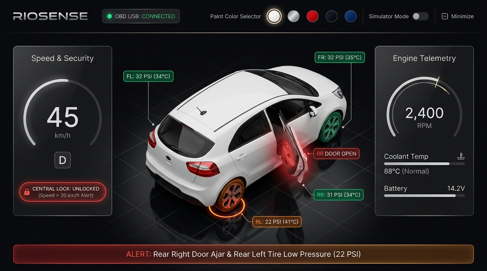
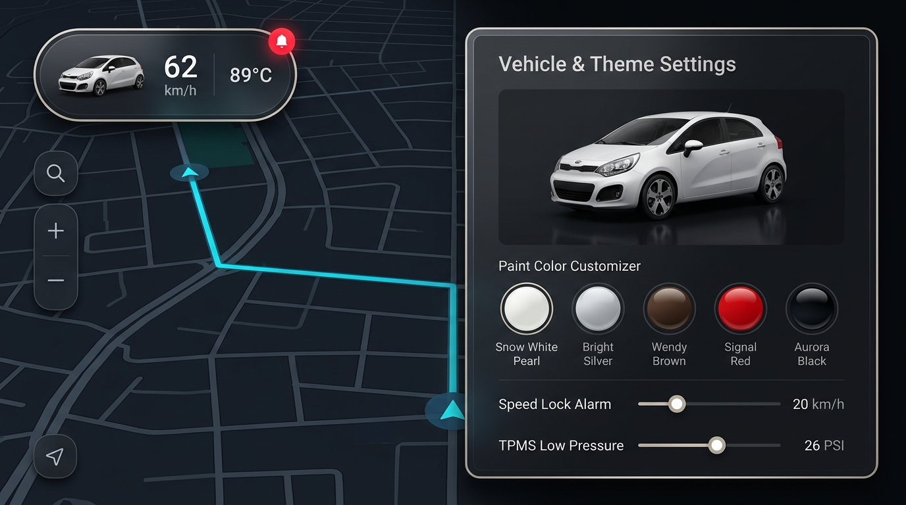

# Desain UI/UX RioSense — Kia Rio UB 2015 (Premium Obsidian Edition)

Dokumen ini menampilkan konsep visual *mockup* antarmuka **RioSense** untuk Head Unit Android Orca Eco Plus (rasio layar *landscape* 16:9), mengusung tema **Premium Obsidian Black** (`#08090C`) dengan aksen *smoked glassmorphism*, silver metalik tipis, dan indikator peringatan kontekstual.

---

## 1. Tampilan Utama Dashboard (Main Dashboard UI)

---

## 2. Mode Minimize (Floating Pill) & Pengaturan Warna Mobil

---

## Bedah Komponen Antarmuka (UI/UX Breakdown)

### 1. Panggung Utama 3D Interaktif (Tengah)
* **Model 3D Kia Rio UB (5-Door Hatchback):** Warna *default* **Snow White Pearl** dengan pencahayaan studio gelap di atas *reflective grid* halus agar kontras dengan bodi putih namun tidak menyilaukan mata saat menyetir malam hari.
* **Deteksi Pintu Realtime:** Saat salah satu pintu belum rapat (contoh: Pintu Kanan Belakang / `RR Door`), pintu pada model 3D langsung terbuka secara fisik disertai pendaran cahaya merah (*crimson aura*) tepat di celah pintu tersebut dan *floating callout* penunjuk.
* **Visualisasi TPMS 4 Roda:** Menampilkan tekanan (`PSI`) dan suhu ban (`°C`) di keempat sudut. Roda yang mengalami tekanan rendah (misal `< 26 PSI`) otomatis menyala dengan cincin warna merah/oranye berdenyut pada ban 3D-nya.

### 2. Panel Kiri — Kecepatan & Keamanan Bodi
* **Digital Speedometer Presisi:** Angka kecepatan besar dengan tipografi *automotive modern* yang mudah dilirik dalam 0,5 detik, dilengkapi indikator posisi transmisi.
* **Indikator Central Lock Pintar:** Menampilkan status kunci pintu (`LOCKED` dengan aksen hijau tenang, atau `UNLOCKED` menyala merah disertai bunyi *chime* saat kecepatan melampaui batas aman `> 20 km/h`).

### 3. Panel Kanan — Telemetri Mesin (OBD2)
* **Radial Arc Tachometer (RPM):** Busur RPM minimalis yang bergerak mulus (60 FPS) dengan gradasi warna dinamis (putih/perak di putaran rendah, berubah ke amber/merah mendekati *redline*).
* **Suhu Coolant & Voltase Aki:** Bar horizontal untuk memantau suhu mesin (`°C`) dan tegangan pengisian alternator (`V`) secara *realtime*.

### 4. Top Bar & Simulator Mode
* **Pemilih Warna Mobil Cepat (*Quick Paint Swatch*):** Tersedia di bagian atas dan menu *Settings* untuk mengganti warna cat 3D Kia Rio secara instan (*Snow White Pearl, Bright Silver, Wendy Brown, Signal Red, Aurora Black*).
* **Toggle Simulator Mode:** Memungkinkan pengujian seluruh animasi pintu, ban kempes, suhu mesin, dan alarm kecepatan langsung dari layar sebelum kabel OBD dipasang.
* **Tombol Minimize (`_`):** Mengecilkan aplikasi menjadi *Floating Pill Widget* di atas Google Maps / Spotify yang otomatis membesar kembali (*auto pop-up*) jika terjadi alarm pintu, *door lock*, suhu tinggi, atau ban kempes.
